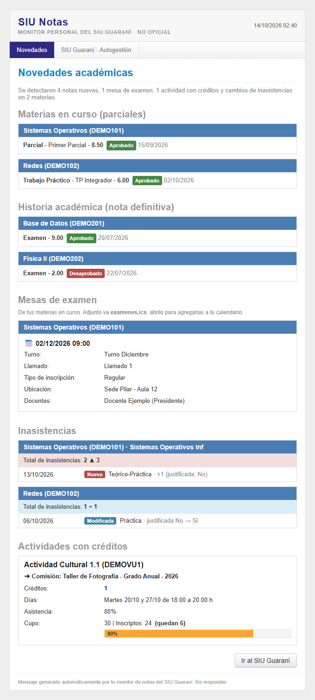
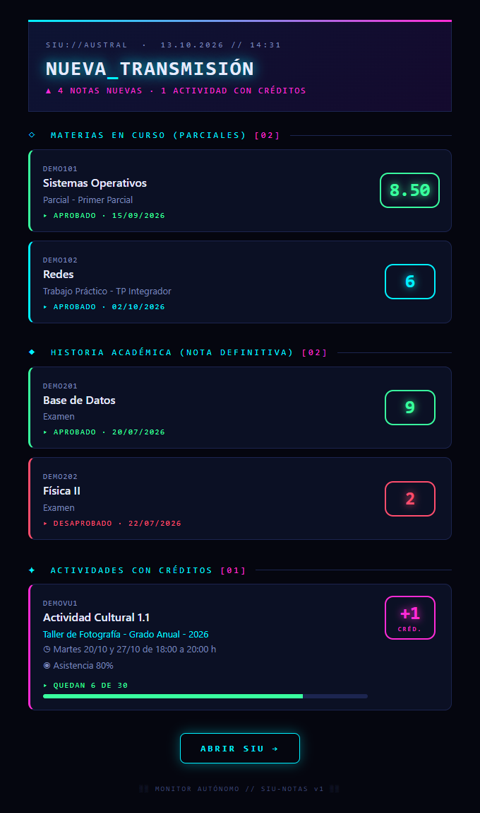

# SIU Notas · Monitor del SIU Guaraní (Universidad Austral)

Revisa tu SIU Guaraní cada hora (salvo de noche) y te manda un **mail solo cuando hay algo nuevo**:

- 📝 **Notas de parciales y TPs** de las materias en curso
- 📄 **Actuación provisoria** (finales recién cargados)
- 🎓 **Historia académica** (nota definitiva)
- 📅 **Mesas de examen** de las materias que estás cursando, con un `.ics` adjunto para agregarlas al calendario
- 🗓️ **Inasistencias**: si suben, bajan o te las justifican (con el total por materia antes → después)
- ⭐ **Actividades que dan créditos** en Inscripción a materias, con días, % de asistencia y cupo restante

Corre en tu propia PC con Windows, usa tu sesión de la Austral y no guarda tu contraseña de la facultad.

| Diseño SIU (por defecto) | Diseño futurista |
|---|---|
|  |  |

<sub>Las capturas usan datos ficticios.</sub>

---

## Requisitos

- **Windows 10/11** con **Microsoft Edge** (viene instalado). macOS y Linux todavía no están implementados, pero el proyecto está preparado para sumarlos: ver [Agregar otro sistema operativo](#agregar-otro-sistema-operativo-macos-linux)
- **Python 3.10+** ([python.org](https://www.python.org/downloads/), marcá "Add to PATH")
- **Git Bash** (viene con [Git for Windows](https://git-scm.com/download/win))
- Una cuenta de **Gmail** con verificación en 2 pasos, para mandar los avisos
- Ser alumno de la Austral con acceso a `siu.austral.edu.ar`

## Instalación

### 1. Clonar e instalar

```bash
git clone <url-de-este-repo> siu-notas
cd siu-notas
./setup.sh
```

`setup.sh` crea el entorno virtual (`.venv`), instala las dependencias y copia `.env.example` a `.env`.

### 2. Configurar `.env`

Abrí `.env` y completá:

| Variable | Qué poner |
|---|---|
| `SMTP_USER` | Tu Gmail, la cuenta que **envía** el aviso |
| `SMTP_PASS` | Una **contraseña de aplicación** de Gmail (ver abajo). **No** tu contraseña normal |
| `MAIL_TO` | A dónde querés recibir los avisos (puede ser el mismo Gmail) |
| `SIU_CARRERA` | Tu carrera **tal como aparece** en el selector "Propuesta" de arriba a la derecha del SIU (ej. `Ingeniería en informática`). Dejalo vacío si tenés una sola |
| `SIU_SILENCIO` | Horas sin revisar, `desde-hasta` en formato 24 h (por defecto en el ejemplo `0-7`). Vacío = revisa siempre |
| `MAIL_TEMA` | `siu` (formal, por defecto) o `futurista` |
| `SIU_NAVEGADOR` | *(Opcional)* Navegador a usar (`msedge`, `chrome`). Por defecto, el de tu sistema operativo |

**Contraseña de aplicación de Gmail:**
1. Activá la verificación en 2 pasos en <https://myaccount.google.com/security>.
2. Entrá a <https://myaccount.google.com/apppasswords>, poné un nombre (`siu-notas`) y tocá **Crear**.
3. Copiá las 16 letras en `SMTP_PASS`. Si alguna vez se filtra, la borrás desde esa misma página.

> ⚠️ ¿Por qué `SIU_CARRERA`? Si estás en más de una propuesta (por ejemplo "Aspirantes" y tu carrera), el SIU abre la primera por defecto, que puede no ser tu carrera. Sin este dato el monitor puede leer la propuesta equivocada.

### 3. Probar

```bash
.venv/Scripts/python siu_notas.py test-mail
```
Te tiene que llegar un mail de prueba.

```bash
.venv/Scripts/python siu_notas.py check
```
La primera vez **guarda como base** las notas que ya tenés y no te avisa de ellas. Las actividades con créditos sí te las manda la primera vez, así sabés cuáles hay disponibles.

Si dice **"Sesión vencida"**, logueate una vez a mano (ver [Login](#cómo-entra-al-siu)):

```bash
.venv/Scripts/python siu_notas.py login
```

### 4. Programar (cada 60 minutos)

```bash
./setup.sh programar
```

Esto crea la tarea **"SIU notas"** en el Programador de tareas de Windows, configurada para:
- correr también **con batería**,
- correr apenas la PC se despierta si estaba suspendida a la hora programada,
- cortar una corrida si tarda más de 10 minutos y no superponer corridas.

Para usar otro intervalo: `SIU_INTERVALO_MIN=30 ./setup.sh programar`. Para borrarla: `./setup.sh desprogramar`.

### 5. (Opcional) Aviso por WhatsApp

Además del mail, te puede llegar un WhatsApp corto cada vez que hay novedades, usando [CallMeBot](https://www.callmebot.com/blog/free-api-whatsapp-messages/) (gratis, solo uso personal).

1. Agendá el número del bot de CallMeBot. Está en [su página](https://www.callmebot.com/blog/free-api-whatsapp-messages/); fijate ahí porque puede cambiar.
2. Mandale por WhatsApp, desde **tu** número: `I allow callmebot to send me messages`
3. Te responde con tu **apikey**. Si no llega en 2 minutos, probá de nuevo en 24 h.
4. Completá en `.env`: `WHATSAPP_TELEFONO` (Argentina: `+549` + área + número, sin el 15) y `WHATSAPP_APIKEY`.
5. Probá:
   ```bash
   .venv/Scripts/python siu_notas.py test-whatsapp
   ```

Cómo funciona y qué tener en cuenta:
- Los mensajes salen **del número de CallMeBot hacia el tuyo**. Tu cuenta de WhatsApp no se automatiza, así que tu número no corre riesgo.
- Por defecto (`WHATSAPP_DETALLE=resumen`) solo dice **cuántas** novedades hay ("1 nota nueva · inasistencias en 1 materia") y te manda al mail. Las notas y materias **no** pasan por CallMeBot. Con `WHATSAPP_DETALLE=completo` se incluye el detalle.
- También avisa "sesión caída" y "el monitor está fallando".
- Es complementario: si CallMeBot falla o deja de existir, queda en el log y el mail llega igual.
- Cada persona activa **su propio** número y su propia apikey. No compartas la tuya.

---

## Cómo funciona

```
Programador de tareas (cada 60 min)
  └─ pythonw siu_notas.py check        (sin ventanas, ~30 s)
       0. Si es horario de silencio (SIU_SILENCIO) termina sin abrir nada
       1. Abre Edge en modo headless con un perfil propio (./perfil)
       2. Entra al SIU (login de Microsoft por SSO)
       3. Elige tu carrera (SIU_CARRERA)
       4. Lee:
          • Historia académica → Materias en curso → "Detalle" de cada una (parciales/TPs)
          • Actuación provisoria (Cursadas / Promociones / Exámenes)
          • Historia académica → Historia completa
          • Inscripción a materias → cada actividad → comisiones con "N créditos" en Observaciones
          • Reportes → Inasistencias
          • Inscripción a exámenes → solo las materias en curso (por código) → mesas
       5. Compara contra todo lo ya visto (estado/snapshot.json)
       6. Si hay algo nuevo → mail. Si no → nada.
```

### ¿Cuándo llega un mail?

| Evento | Mail |
|---|---|
| Nota nueva (parcial/TP, actuación provisoria o definitiva) | ✅ una vez |
| Nota corregida (ej. 6 → 7) | ✅ (es una línea nueva) |
| Aparece una mesa de examen de una materia en curso | ✅ con fecha, turno, sede, docentes y `examenes.ics` adjunto (duración estimada en 2 h: el SIU no la informa) |
| Inasistencia nueva, quitada o modificada (cantidad o justificación) | ✅ con el total de la materia antes → después |
| Aparece una comisión nueva que da créditos | ✅ con días, asistencia y cupo de ese momento |
| Cambia el cupo de una actividad ya avisada | ❌ |
| Revisión sin cambios | ❌ |
| No puede entrar al SIU | ⚠️ **un** aviso, hasta que se arregle |
| Error pasajero (sin red al despertar la notebook, SIU lento) | ❌ reintenta al minuto; si sigue, lo intenta en la próxima revisión |
| El script falla **3 revisiones seguidas** (cambió la página, sin red hace horas, etc.) | ⚠️ **un** aviso, hasta que vuelva a andar |

La foto en `estado/snapshot.json` **acumula** todo lo visto: si una corrida lee de menos (un detalle que no cargó, una materia que pasó de "en curso" a la historia), esas notas no se vuelven a avisar cuando reaparecen. Las **inasistencias** son la excepción: como pueden bajar o justificarse, se guarda la foto completa de cada corrida y se compara entera (nuevas, quitadas y modificadas). Si el reporte no carga bien, la corrida cuenta como error en vez de interpretarse como "se borraron tus faltas".

### Cómo entra al SIU

El SIU de la Austral usa login de **Microsoft (SAML)**, con MFA. El monitor **nunca maneja tu contraseña**:

- Si tu Windows tiene vinculada la cuenta de la Austral (*Configuración → Cuentas → Obtener acceso a trabajo o escuela*), Edge entra solo por SSO y no hay que hacer nada.
- Si no, corré `siu_notas.py login`: se abre Edge, te logueás vos (MFA incluido) y en "¿Mantener la sesión iniciada?" ponés **Sí**. La sesión queda en `./perfil` y el monitor la reutiliza hasta que Microsoft la venza. Cuando pase, te llega un mail para repetir el login.

### Seguridad y privacidad

- **Solo lee.** En Inscripción a materias y a exámenes abre cada actividad para mirarla y **nunca** envía el formulario de "Inscribirse" ni "Dar de baja".
- `.env` (Gmail), `perfil/` (sesión de Microsoft), `estado/` (tus notas) y `capturas/` están en `.gitignore`. **No los subas nunca.**
- Los mails salen de tu Gmail a vos. Ningún servicio externo ve tus notas.
- Frecuencia razonable (cada hora, nada de noche) para no cargar el servidor de la facultad.

---

## Comandos

| Comando | Qué hace |
|---|---|
| `.venv/Scripts/python siu_notas.py check` | Una revisión completa (lo que corre la tarea) |
| `.venv/Scripts/python siu_notas.py test-mail` | Manda un mail de muestra con notas ya vistas |
| `.venv/Scripts/python siu_notas.py test-whatsapp` | Manda un WhatsApp de prueba (si está configurado) |
| `.venv/Scripts/python siu_notas.py login` | Abre Edge para loguearte a mano |
| `.venv/Scripts/python siu_notas.py dump` | Guarda lo que lee en `capturas/filas.json` (para depurar) |
| `.venv/Scripts/python siu_notas.py verificar` | Chequea los requisitos del sistema (navegador, venv) |
| `tail -20 estado/siu.log` | Ver las últimas revisiones |
| `./setup.sh programar` / `desprogramar` | Crear / borrar la tarea programada (usa `siu_notas.py programar` / `desprogramar`) |

<sub>En macOS/Linux, el python del venv es `.venv/bin/python` en lugar de `.venv/Scripts/python`.</sub>

## Problemas comunes

| Síntoma | Solución |
|---|---|
| `python-dotenv could not parse statement` | Hay una línea rota en `.env` (por ejemplo un comando pegado sin querer). Dejá solo líneas `CLAVE=valor` o comentarios `#` |
| `SMTPAuthenticationError` | `SMTP_PASS` no es una contraseña de aplicación, o la verificación en 2 pasos no está activa |
| "Sesión vencida" en el log o por mail | `.venv/Scripts/python siu_notas.py login` |
| `No encontré la carrera '...'` | `SIU_CARRERA` no coincide con el texto del selector "Propuesta" del SIU (las tildes y mayúsculas no importan) |
| Las notas que te llegan no son de tu carrera | Configurá `SIU_CARRERA` |
| No llegan mails nunca | Mirá `estado/siu.log`. Si `ultima_corrida` en `estado/snapshot.json` no avanza, revisá la tarea en el Programador de tareas |
| La tarea no corre con la notebook desenchufada | Volvé a correr `./setup.sh programar` (configura la batería) |

## Limitaciones

- Con el intervalo de 60 min, un aviso puede llegar hasta una hora tarde. En actividades con créditos de pocos cupos eso puede ser la diferencia: si te importa, usá `SIU_INTERVALO_MIN=30 ./setup.sh programar`.
- Lo que se cargue en el horario de silencio llega en la primera revisión después (por defecto, a las 7).
- Necesita la PC **prendida y con tu sesión de Windows iniciada**. Si estuvo apagada, al prenderla te llegan juntas las novedades acumuladas.
- Depende del HTML del SIU Guaraní de la Austral: si lo actualizan, puede dejar de leer bien (te llega el aviso de error).
- Créditos: solo detecta las actividades cuyas **Observaciones** dicen explícitamente "N crédito(s)".
- Por ahora solo hay implementación para Windows (ver la sección siguiente para sumar otros sistemas).

## Estructura

```
siu_notas.py            # scraping, comparación, mail y comandos (no sabe en qué SO corre)
plataformas/
  __init__.py           # interfaz Plataforma + registro por sistema operativo
  windows.py            # Edge + Programador de tareas (PowerShell)
mail_ui_siu.py          # diseño del mail formal tipo SIU
mail_ui.py              # diseño del mail futurista
whatsapp.py             # aviso opcional por WhatsApp (CallMeBot)
setup.sh                # instalación (bash, multiplataforma) y atajos para programar
.env.example            # plantilla de configuración
docs/                   # imágenes del README (datos ficticios) y su generador
```

## Agregar otro sistema operativo (macOS, Linux)

Todo lo que depende del sistema operativo está detrás de la interfaz `Plataforma`
([plataformas/\_\_init\_\_.py](plataformas/__init__.py)). El scraping, la comparación, los mails y
`setup.sh` **no se tocan**: solo hay que crear un archivo y registrarlo.

**1. Crear `plataformas/macos.py`** con una subclase que implemente el contrato:

| Miembro | Qué hace | Windows (referencia) | Idea para macOS |
|---|---|---|---|
| `canal_navegador` | `channel` de Playwright | `"msedge"` | `"chrome"` o `"msedge"` (Edge para Mac existe) |
| `python` | Python del venv | `.venv/Scripts/python.exe` | `.venv/bin/python` |
| `python_sin_consola` | Python para la tarea, sin ventanas *(opcional)* | `pythonw.exe` | No hace falta: el valor por defecto (`python`) sirve |
| `verificar_requisitos()` | Lista de problemas (vacía = OK) | ¿Existe `msedge.exe`? | ¿Existe `/Applications/Google Chrome.app`? |
| `programar(nombre, intervalo_min)` | Crea la ejecución periódica de `siu_notas.py check` | Programador de tareas vía PowerShell | Un **LaunchAgent**: plist en `~/Library/LaunchAgents/` con `StartInterval` = `intervalo_min*60`, `WorkingDirectory` y logs, y después `launchctl bootstrap gui/$UID <plist>` |
| `desprogramar(nombre)` | La elimina | `Unregister-ScheduledTask` | `launchctl bootout gui/$UID <plist>` y borrar el plist |

`programar` tiene que respetar lo mismo que en Windows: correr con batería, recuperar la corrida perdida si la máquina estaba dormida y no superponer corridas.

**2. Registrarla** en `REGISTRO` (mismo archivo `__init__.py`), con la clave de `sys.platform`:

```python
REGISTRO = {
    "win32": ("plataformas.windows", "Windows"),
    "darwin": ("plataformas.macos", "MacOS"),
}
```

**3. Probar:**

```bash
./setup.sh
```
```bash
.venv/bin/python siu_notas.py verificar
```
```bash
.venv/bin/python siu_notas.py check
```
```bash
./setup.sh programar
```

**Login en macOS:** el SSO automático que hace Edge en Windows con la cuenta vinculada no existe en Mac. Hay que correr `siu_notas.py login` una vez y elegir "Mantener la sesión iniciada".

Si te olvidás de algún método, Python no deja crear la clase y te dice cuál falta. Si el sistema no está registrado, el error dice qué archivo mirar.

## Aviso

Proyecto personal, no oficial, sin relación con la Universidad Austral ni con el consorcio SIU. Usalo con tu propia cuenta y bajo tu responsabilidad, respetando las políticas de uso de la universidad.
